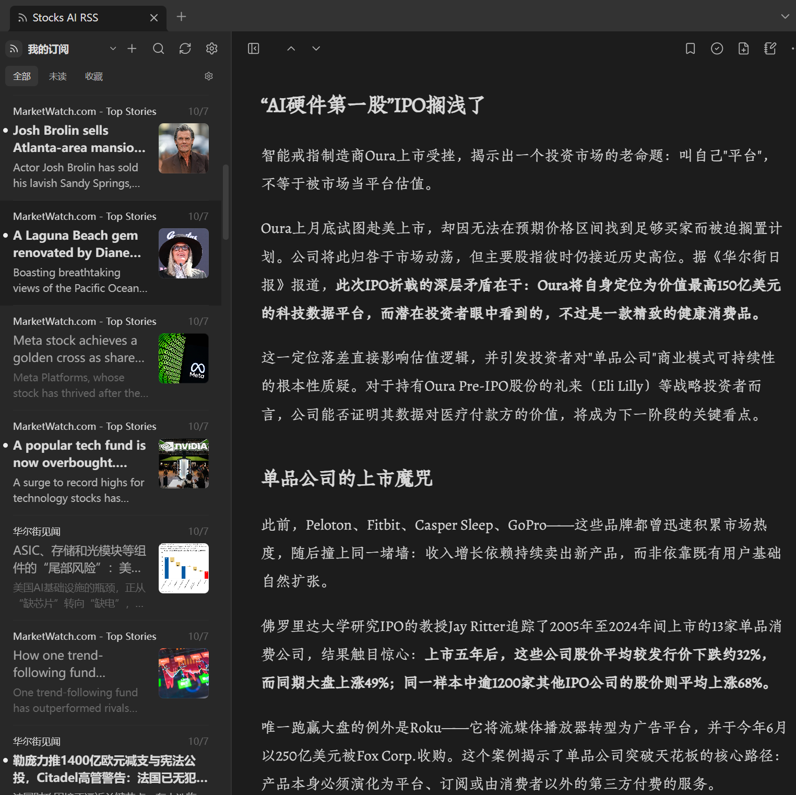

**[中文](README.md) | [English](README.en.md) | [日本語](README.ja.md)**

<div align="center">

# 📈 Stocks AI RSS

**US stocks · AI · Semiconductors · Gold · BTC — five market themes plus Chinese, Japanese and Spanish sections, straight into your Obsidian**

[](https://github.com/Serennity007/serenity-stock-rss/releases)
[](LICENSE)


*Free · Open source · No account · Fully local · 45 bundled feeds*



</div>

---

Investment decisions are only as good as the information behind them. But today the flow looks like this: AI breaking news on X, semiconductor deep-dives behind paywalls, BTC rumors broadcast across a dozen group chats, gold quotes buried in trading apps — **consumed once, remembered nowhere, never entering your knowledge base**.

**Stocks AI RSS** closes that loop inside Obsidian: **45 finance feeds, each hand-verified to work over direct HTTPS**, organized into five market themes and three language sections — and any article worth keeping becomes a Markdown note or a daily-note excerpt in one click. The "read RSS → save to notes" loop runs entirely on your machine: long-form typography, adjustable fonts and themes, J/K keyboard flow, no server in the loop.

## 🔥 Five themes and three language sections, one-click subscribe

| Theme | Bundled feeds | What you'll read |
| --- | --- | --- |
| 🇺🇸 **US equities** (8) | CNBC ×3 · MarketWatch · WSJ ×2 · Seeking Alpha · Fortune | Market moves, earnings season, single-stock news |
| 🤖 **AI & LLMs** (5) | OpenAI · TechCrunch AI · Interconnects · Simon Willison · 量子位 | Model releases, AI startups & funding, LLM research, Chinese AI industry |
| 💾 **Semiconductors** (4) | SemiAnalysis · Tom's Hardware · SemiWiki · EE Times | Compute supply chain, process nodes, chip design |
| 🪙 **Gold & crypto** (6) | MINING.com · FXStreet · The Block · Cointelegraph · Bitcoin Magazine · Decrypt | Gold supply side, BTC markets, institutional adoption & regulation |
| 🏛️ **Macro** (3) | CNBC Economy · Federal Reserve · SEC | FOMC decisions, jobs & inflation data, rulemaking |
| 🇯🇵 **Japanese finance** (5) | 財経新聞 · Yahoo!ニュース（経済） · FNN · ITmedia · GIGAZINE | The Japanese read on the TOPIX/Nikkei tape, US long yields and the Fed, Japan's AI & chip supply chain |
| 🇪🇸 **Spanish finance** (6) | Expansión ×2 · El Mundo · La Vanguardia · 20minutos · Xataka | IBEX, European debt and power prices, Spain's housing policy and corporate news |

Three auxiliary collections round it out: **Chinese finance** (华尔街见闻, Sina Finance, TMTPost), **Chinese tech** (InfoQ 中文, GeekPark, ifanr) and **finance blogs** (Ben Carlson, Josh Brown) — **45 feeds** in total. Language sections keep their categories in the source language (日本市場 / Economía / Mercados), so the subscription group a feed lands in is spelled natively rather than translated. Want Xueqiu or Cailianshe (no official RSS)? Self-host [RSSHub](https://docs.rsshub.app/) and paste the link into the discovery panel.

## ✨ Why it earns a place in your vault

- ✍️ **The last mile from information to knowledge** — save any article as Markdown (images localized, so notes survive link rot), or append a selected paragraph straight into today's daily note with the source link attached
- 📊 **Institutional-grade sources next to the tape** — SemiAnalysis and Interconnects sit in the same reader as breaking-news feeds; no more app-hopping between the tape and the deep dives
- 🗂️ **Organize it your way** — subscription groups, OPML import/export, vault folders as reading sources (your clipped research notes become readable)
- 📖 **Typography tuned for long reads** — 7 themes, 8 fonts (bundled Zhuque Fangsong subset), adjustable size/line-height/column width, J/K keyboard flow
- 🔒 **Fully local** — no accounts, no telemetry; read state, favorites and cache stay in your vault. The plugin has no server dependency — it keeps working even if this repo disappears

## 🚀 Install

**Option 1: BRAT (recommended, auto-updates)**

1. Install the [BRAT](https://github.com/TfTHacker/obsidian42-brat) plugin
2. BRAT settings → *Add Beta plugin* → enter `Serennity007/serenity-stock-rss`
3. Enable it under community plugins

**Option 2: Manual**

1. Download `main.js`, `manifest.json`, `styles.css` from [Releases](https://github.com/Serennity007/serenity-stock-rss/releases)
2. Put them into `<vault>/.obsidian/plugins/stocks-ai-rss/`
3. Settings → Community plugins → enable **Stocks AI RSS**

> Plugin ID is `stocks-ai-rss`, so it never clashes with other RSS plugins in your vault.

## ❓ FAQ

**Why these five themes?**
US equities anchor the market; AI and semiconductors are the defining industrial narrative of this cycle (and each other's supply chain); gold and BTC are twin mirrors of fiat confidence. Layered with official macro sources, they form a self-consistent research surface. Chinese sources stay as an auxiliary collection because high-quality Chinese content rarely offers RSS.

**Will the catalog be updated?**
Yes. The bundled catalog is a standalone data file ([finance-feeds.json](src/data/finance-feeds.json), CC0). To add or fix a feed, PR that file with availability verification. At runtime you can also override the bundled catalog by dropping a `finance-catalog.json` into the plugin folder (`.obsidian/plugins/stocks-ai-rss/`): the file must match the catalog schema, contain at least one feed, and carry a newer `generated_at` than the bundled snapshot (which uses `YYYY-MM-DD`, e.g. `2026-10-07`; `revision` is compared when `generated_at` is absent). A file that fails schema validation or is not newer is ignored.

**Is my data safe?**
The plugin has no server of its own. Subscriptions are the feed URLs you add; articles live under `.obsidian/plugins/stocks-ai-rss/` in your vault. Uninstalling never touches your saved notes.

**How does it differ from other RSS plugins?**

| | Typical online RSS plugin | Stocks AI RSS |
| --- | --- | --- |
| Content | Online curated service + personal feeds | Personal feeds + bundled five-theme catalog |
| Chinese AI rewrite/translation | Yes (server-generated) | No, original text only |
| Podcast transcripts, link-collection lab | Yes | Removed |
| Network dependency | Curated content needs the service | Only the feeds you subscribe to |

## 🛠️ Development

```bash
npm ci
npm run check   # eslint + vitest + tsc + esbuild
```

PRs welcome for new feeds and improvements — see [CONTRIBUTING.md](CONTRIBUTING.md).

## 🙏 Acknowledgements

- The bundled Zhuque Fangsong font subset is based on [Zhuque Fangsong](https://github.com/TrionesType/zhuque) (SIL OFL 1.1).

## 📄 License

[GPL-3.0-only](LICENSE). The upstream source and copyright notice, plus third-party notices, live at the end of [LICENSE](LICENSE) and in [THIRD_PARTY_NOTICES.md](THIRD_PARTY_NOTICES.md).
